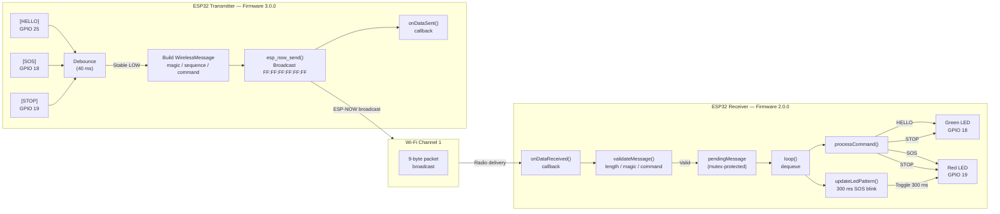
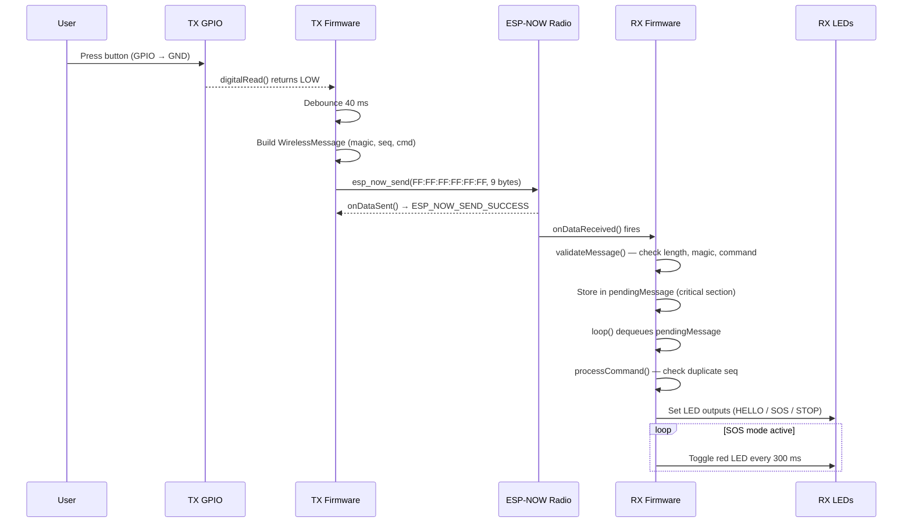

# System Architecture

This document presents the architecture and data-flow of the EMT Wireless Communication System as implemented in the existing firmware.

---

## High-Level Component Diagram



---

## Data-Flow Sequence Diagram



---

## Software Layer Stack

```
┌─────────────────────────────────────────────────┐
│           Application Logic (Arduino .ino)       │
│  updateButtons() / sendCommand() / processCommand()│
├─────────────────────────────────────────────────┤
│               ESP-NOW API                        │
│  esp_now_init / esp_now_send / callbacks         │
├─────────────────────────────────────────────────┤
│               ESP-IDF Wi-Fi Driver               │
│  esp_wifi_set_channel / WIFI_STA mode            │
├─────────────────────────────────────────────────┤
│           ESP32 Hardware (Radio / GPIO)           │
└─────────────────────────────────────────────────┘
```

---

## Key Design Decisions Found in the Source Code

| Decision | Location | Rationale (as observed) |
|----------|----------|-------------------------|
| Broadcast MAC (`FF:FF:FF:FF:FF:FF`) | `TRANSMITTER_esp.ino` L66–68 | No receiver MAC needs to be hard-coded |
| Packed 9-byte struct + `static_assert` | Both files | Ensures sender and receiver agree on layout |
| `portENTER_CRITICAL` / `portEXIT_CRITICAL` | `RECEIVER_esp32.ino` L167–172, L378–386 | Safe handoff from Wi-Fi task to loop task |
| Dual SDK version guards (`#if ESP_ARDUINO_VERSION_MAJOR >= 3`) | Both files | Supports Arduino ESP32 core v2 and v3 |
| 40 ms debounce | `TRANSMITTER_esp.ino` L36 | Prevents contact bounce from generating duplicate sends |
| Sequence number duplicate check | `RECEIVER_esp32.ino` L215–220 | Suppresses repeated processing of the same packet |
| Non-blocking SOS blink | `RECEIVER_esp32.ino` L271–290 | `millis()` comparison avoids `delay()` in loop |
